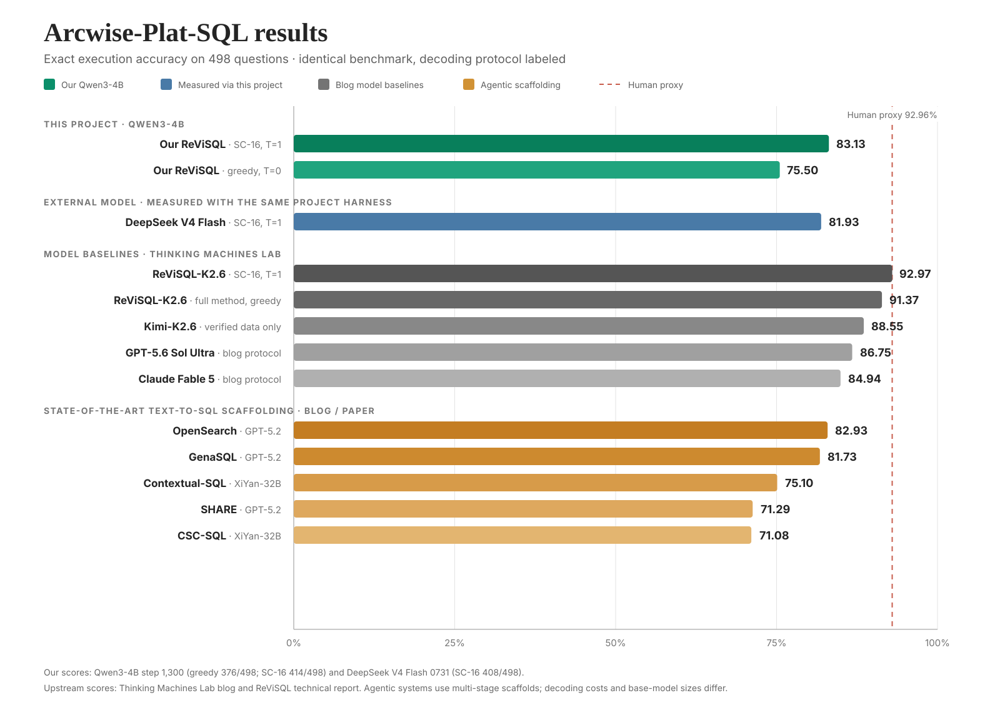
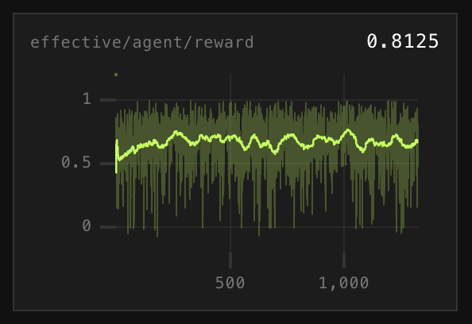
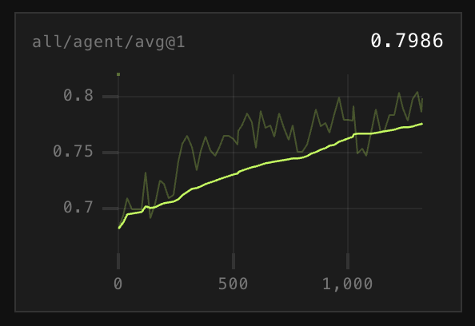
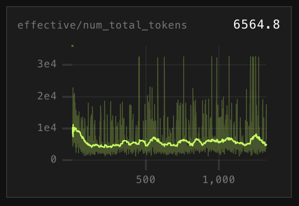
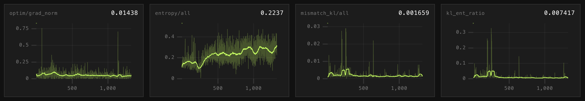

# ReViSQL-BIRD: Qwen3-4B Text-to-SQL RLVR

**English** | [简体中文](README.zh-CN.md)

Starting directly from the original `Qwen3-4B-Instruct-2507`, RLVR training on
BIRD-Platinum yields a best checkpoint that achieves **75.50% greedy** and
**83.13% SC-16** on Arcwise-Plat-SQL, and **81.12% greedy** on the fully corrected
Arcwise-Plat benchmark.



| Dataset | Exact execution | Notes |
| --- | ---: | --- |
| **Arcwise-Plat** | **404/498 = 81.12%** | Fully corrected SQL, questions, evidence, and schemas |
| **Arcwise-Plat-SQL** | **376/498 = 75.50%** | SQL-only corrections; matches the main leaderboard setting in the reference article |
| BIRD Full Dev | 961/1,534 = 62.65% | Original, noisy annotations |
| BIRD Mini-Dev | 298/500 = 59.60% | Original, noisy annotations |

> Upstream results in the chart come from Thinking Machines Lab's
[ReViSQL article](https://thinkingmachines.ai/news/putting-task-expertise-into-rl/)
and [technical report](https://arxiv.org/abs/2603.20004). In addition to
ReViSQL-K2.6, GPT-5.6 Sol Ultra, and Claude Fable 5, the chart includes five
agentic text-to-SQL scaffolds using GPT-5.2 or XiYan-32B. DeepSeek V4 Flash and
this project's SC-16 results were measured in this repository using the same
protocol: 16 candidates at `temperature=1`, with majority voting over execution
results. Model sizes and inference protocols are labeled in the chart.

> See [docs/RESULTS.md](docs/RESULTS.md) for the complete experiment record.

The validation-selected step 1,300 LoRA adapter is available on
[Hugging Face: ximosss/ReViSQL-Qwen3-4B](https://huggingface.co/ximosss/ReViSQL-Qwen3-4B).

## Motivation

For customer-service automation, querying a database directly with SQL offers
more flexibility than a fixed set of buttons and predefined question-and-answer
templates. Traditional rule-based systems—and many customer-service agents—are
limited by narrowly scoped business APIs. A SQL agent instead exposes the
flexibility of database access itself, substantially expanding the range of
queries and operations users can request. However, direct access to internal
databases raises data-security and privacy concerns that can rule out sending
requests to hosted frontier models. An intermediary layer can mitigate these
concerns, but a locally deployed model is an appealing alternative. The question
is whether a SQL agent powered by a local small language model can approach
frontier-model performance on complex, real-world business tasks.

Intuitively, the action space of SQL queries (DQL) is relatively constrained:
each keyword has a limited set of valid uses, so learning valid combinations
should be tractable. Much of the remaining challenge is semantic
understanding—identifying entity attributes and relationships—which is a core
strength of language models. SQL is also fast and inexpensive to verify using
local database files: it provides both a concrete result and an execution process
that can be inspected and analyzed. This makes direct reinforcement learning
with verifiable rewards (RLVR), without an intermediate supervised fine-tuning
(SFT) stage, a promising approach.

The collaboration between Yuxuan Zhu and colleagues and Thinking Machines Lab
provides a compelling example. Their ReViSQL-K2.6, trained with RLVR on
Kimi-K2.6, demonstrated human-level text-to-SQL accuracy. Yet Kimi-K2.6 is not a
practical local model for this use case: deploying such a large model solely for
text-to-SQL, or as a specialized subagent or tool for another model, is difficult
to justify. The premise of this project is that SQL generation draws on general
language-model capabilities within a narrow task distribution—and a small
language model should be able to learn it too.

## Method

This project largely reproduces the ReViSQL-BIRD method proposed by Yuxuan Zhu
and colleagues, whose work I gratefully acknowledge. Inspired by VibeThinker-3B,
I start RLVR directly from the original Qwen3-4B-Instruct-2507. To adapt the method
to Qwen3-4B and a local Prime-RL training environment, I make the following changes:

1. **Adjust the optimization settings**

   Reduce the learning rate from `5×10⁻⁵` to `1×10⁻⁵` to limit update magnitudes
   for a small model trained with LoRA. Keep LoRA rank at 32 and set alpha to 64,
   targeting the main linear layers in both attention and MLP blocks.

2. **Reduce the effective training batch**

   In the original Tinker recipe, a batch size of 64 means 64 question groups per
   step, with 16 rollouts per question—up to roughly 1,024 trajectories. In
   Prime-RL, a batch size of 64 means 64 rollouts in total, so a group size of 16
   yields only four question groups per step.

   This shifts training from larger batches with fewer updates to smaller
   batches with more updates. I compensate for the lower per-step question
   coverage with a longer training run.

3. **Lower the rollout sampling temperature**

   Preliminary experiments showed severe formatting errors and omissions.
   Increasing the format penalty did not substantially help, so I lower the
   training sampling temperature from the original method's default of `1.0`
   to `0.8`.

4. **Simplify the in-context example dialogue**

   The original method includes a complete one-shot database-exploration
   dialogue in the prompt. To reduce fixed context overhead, I remove this
   prefix and specify tool use, multi-turn exploration, and the final-answer
   format directly in the system prompt instead.

5. **Compress and bound database observations**

   The SQL tool returns at most 50 rows, truncates each cell to 200 characters,
   and caps the entire observation at 12,000 characters. This prevents wide
   tables or long text fields from quickly exhausting Qwen3-4B's context window.

6. **Include a few real data rows in the schema**

   Earlier error analysis showed that the model sometimes failed to correct
   small mistakes. I therefore include up to three real sample rows per table
   to help it recognize actual date formats, enum values, identifiers, casing,
   and NULL values.

7. **Adjust the format reward**

   Early in training, the format-error reward had an outsized effect and
   overshadowed the execution-accuracy reward. I set the reward for a format
   error to `-0.05` so that frequent early formatting failures do not dominate
   the learning signal.

Before this, I explored a two-stage SFT–RL approach, attempting to expand the
model's SQL capabilities with teacher-generated chains of thought. However,
insufficient control over the SFT dataset led the model to memorize many of its
questions, making it difficult to obtain useful within-group advantage signals
during subsequent RL training.

Even after examining the base model's evaluation pass rate and error
distribution during the RL stage, I could not determine whether the failures
stemmed from problems in the BIRD training data or limitations of the model
itself. Thinking Machines Lab's blog finally provided a clean dataset and an
effective training recipe. I am particularly grateful for that contribution.

<p align="center">
  
  
  
</p>

<p align="center">
  
</p>

## Project Overview

This project reproduces the core ReViSQL approach and adapts it to Qwen3-4B.
It trains a text-to-SQL model using expert-corrected BIRD-Platinum data, CISPO,
SQL execution rewards, VeriEQL semantic verification, and an evidence process
reward. The model can perform up to five rounds of read-only database interaction
and submits its final answer as `<solution>SQL</solution>`.

Main configuration:
[`configs/prime-rl/rl-revisql-bird-qwen3-4b-v1.toml`](configs/prime-rl/rl-revisql-bird-qwen3-4b-v1.toml).
Final weights:
[`ximosss/ReViSQL-Qwen3-4B`](https://huggingface.co/ximosss/ReViSQL-Qwen3-4B)
(LoRA adapter).

| Setting | Value |
| --- | --- |
| Base model | Qwen3-4B-Instruct-2507 |
| Objective | CISPO |
| Batch / group size | 64 / 16 |
| LoRA | rank 32, alpha 64 |
| Learning rate | `1e-5` |
| Context / output per turn | 32,768 / 3,072 tokens |
| Training / inference GPUs | 1 / 1 |

## Setup

Requirements: Linux, Python 3.12, `uv`, `prime`, `tmux`, NVIDIA GPUs, a local copy
of Qwen3-4B-Instruct-2507, and the BIRD SQLite databases.

```bash
uv sync --frozen

git clone https://github.com/PrimeIntellect-ai/prime-rl.git prime-rl
git -C prime-rl checkout ab5de8fff44b2c4a5c85e24b6e6e3f7d57eee7b1
git -C prime-rl submodule update --init --recursive
(cd prime-rl && uv sync --all-extras --frozen)

git clone --depth 1 --branch v1.0 \
  https://github.com/VeriEQL/VeriEQL.git third_party/VeriEQL

prime env install bird-text2sql --path environments --plain
```

The default model path is `/data/qwen3-4b-instruct-2507`. When updating local
model and database paths, check these references:

```bash
rg -n '/data/|/home/ubuntu/bird-text2sql-rl' configs/prime-rl scripts
```

Download the final adapter:

```bash
uvx --from huggingface-hub hf download ximosss/ReViSQL-Qwen3-4B \
  --local-dir models/ReViSQL-Qwen3-4B
```

Start the results dashboard:

```bash
./scripts/launch_prime_rl_dashboard.sh start
./scripts/launch_prime_rl_dashboard.sh check
```

The default address is <http://127.0.0.1:7788>. Both training and evaluation run
inside tmux, with all results written to `outputs/prime-rl/`.

## Datasets

| Split | Size | Purpose |
| --- | ---: | --- |
| BIRD-Platinum train | 2,050 | RLVR training |
| BIRD-Platinum validation | 396 | Checkpoint selection |
| Arcwise-Plat / Arcwise-Plat-SQL | 498 / 498 | Main final evaluation |
| BIRD Mini-Dev / Full Dev | 500 / 1,534 | Robustness evaluation with noisy annotations |

Obtain the verified train/validation annotations from
[ReViSQL](https://github.com/uiuc-kang-lab/ReViSQL) and the train/dev SQLite
databases from [BIRD](https://bird-bench.github.io/).
Prepare the execution-ready RLVR data:

```bash
uv run scripts/prepare_rlvr_data.py \
  --verified-train /path/to/ReViSQL/data/bird-verified-train.json \
  --verified-validation /path/to/ReViSQL/data/bird-verified-val.json \
  --database-root /path/to/BIRD/train_databases \
  --output-dir data/processed/rlvr-v2
```

Final evaluation annotations are included in `data/eval/`. See
[data/eval/README.md](data/eval/README.md) for sources and licensing information.

## Training

Run the check before the first run, or when the configuration, code, data, or
model changes:

```bash
./scripts/launch_revisql_bird.sh check
```

Start a 40-step pilot:

```bash
./scripts/launch_revisql_bird.sh pilot <run-name>
tmux attach -t <run-name>
```

Resume an existing run to a specified total number of steps:

```bash
./scripts/launch_revisql_bird.sh resume <run-name> <target-steps>
```

## Evaluation

By default, evaluation uses the step 1,300 adapter and runs the four frozen
datasets sequentially:

```bash
./scripts/launch_revisql_final_eval.sh
```

Run only the main evaluations:

```bash
./scripts/launch_revisql_final_eval.sh arcwise-plat-sql arcwise-plat
```

Evaluate a different adapter:

```bash
BIRD_ADAPTER=/path/to/adapter \
BIRD_CANDIDATE_MODEL_ID=my-model \
BIRD_RUN_PREFIX=my-model \
./scripts/launch_revisql_final_eval.sh arcwise-plat-sql arcwise-plat
```

Evaluation uses greedy single-sample decoding (`temperature=0`) and exact
execution accuracy. See [docs/EVALUATION.md](docs/EVALUATION.md) for the detailed
evaluation contract.

## References

This project directly uses or reproduces the following work:

1. Yuxuan Zhu, Tengjun Jin, Yoojin Choi, and Daniel Kang. 2026. [Human-Level Text-to-SQL via Reinforcement Learning on Verified Data, Without Pipeline Engineering](https://arxiv.org/abs/2603.20004). arXiv:2603.20004. (ReViSQL-BIRD and BIRD-Platinum)

2. Yuxuan Zhu, Tengjun Jin, Yoojin Choi, and Daniel Kang. 2026. [Putting Task Expertise into RL Achieves State-of-the-Art Performance on Text-to-SQL](https://thinkingmachines.ai/news/putting-task-expertise-into-rl/). Thinking Machines Lab.

3. Tengjun Jin, Yoojin Choi, Yuxuan Zhu, and Daniel Kang. 2026. [Pervasive Annotation Errors Break Text-to-SQL Benchmarks and Leaderboards](https://arxiv.org/abs/2601.08778). *Proceedings of the VLDB Endowment*. (Arcwise-Plat and Arcwise-Plat-SQL)

4. Jinyang Li et al. 2023. [Can LLM Already Serve as a Database Interface? A BIg Bench for Large-Scale Database Grounded Text-to-SQLs](https://arxiv.org/abs/2305.03111). *NeurIPS 2023*. (BIRD)

5. Yang He, Pinhan Zhao, Xinyu Wang, and Yuepeng Wang. 2024. [VeriEQL: Bounded Equivalence Verification for Complex SQL Queries with Integrity Constraints](https://arxiv.org/abs/2403.03193). *Proceedings of the ACM on Programming Languages*, 8 (OOPSLA1), 1071–1099.

6. Prime Intellect. 2025. [prime-rl](https://github.com/PrimeIntellect-ai/prime-rl). GitHub repository.

7. William Brown. 2025. [Verifiers: Environments for LLM Reinforcement Learning](https://github.com/PrimeIntellect-ai/verifiers). GitHub repository.
